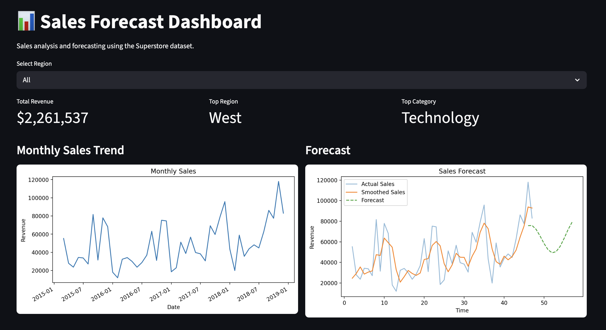

# 📊 Sales Forecast Dashboard

This project analyzes sales data from the Superstore dataset and builds a forecasting model to predict future revenue.  
It also includes an interactive dashboard built with Streamlit to visualize key insights.

---

## 🚀 Features

- 📈 Total Revenue KPI
- 🌍 Top Region identification
- 🛍️ Top Category analysis
- 📊 Monthly Sales Trend visualization
- 🔮 Sales Forecast using Linear Regression
- 🔁 Seasonality modeling using sine and cosine encoding
- 🎛️ Interactive Region filter (Streamlit dashboard)

---

## 🖼️ Dashboard Preview



---

## 🧠 Project Overview

### 1. Data Preparation
- Loaded dataset using Pandas
- Converted `Order Date` to datetime format
- Aggregated sales monthly

### 2. KPI Analysis
- Total Revenue
- Top-performing Region
- Top-performing Category

### 3. Trend Analysis
- Monthly sales trends visualized over time

### 4. Forecasting Model
- Linear Regression used to model sales over time
- Applied **moving average smoothing** to reduce noise
- Added **seasonality encoding** using sine and cosine transformations

### 5. Dashboard
- Built using Streamlit
- Displays KPIs, trends, and forecasts
- Includes interactive filtering by region

---

## 🛠️ Technologies Used

- Python
- Pandas
- NumPy
- Matplotlib
- Scikit-learn
- Streamlit

---

## 📁 Project Structure
```bash
sales-forecast-dashboard/
│── app.py
│── analysis.ipynb
│── requirements.txt
│── screenshots/
│   └── dashboard.png
```
---

## ⚙️ How to Run the Project

### 1. Clone the repository
```bash
git clone https://github.com/SalmaMork/sales-forecast-dashboard.git
cd sales-forecast-dashboard
```
### 2. Install dependencies
```bash
python3 -m pip install -r requirements.txt
```
### 3. Run the dashboard
```bash
python3 -m streamlit run app.py
```
### 4. Open in browser
```bash
http://localhost:8501
```

## 📊 Key Insights
	•	Total revenue is approximately $2.26M
	•	The West region generates the highest sales
	•	Technology is the top-performing category
	•	Sales show an upward trend over time
	•	Seasonality patterns improve forecast accuracy

## 🔮 Future Improvements
	•	Deploy the dashboard online
	•	Use advanced forecasting models (ARIMA, Prophet)
	•	Add more interactive filters
	•	Improve model evaluation with more metrics

## 👩‍💻 Author
Salma Morkani

